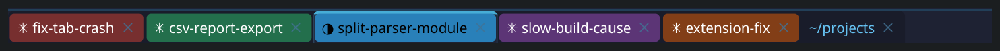

# claude-konsole-customize

Имя и цвет вкладки Konsole для сессий [Claude Code](https://claude.com/claude-code).

```bash
claude -n extension-fix -C purple
```



Вкладка называется `extension-fix` (со значком статуса Claude) и залита фиолетовым целиком. После выхода из Claude цвет вкладки возвращается к прежнему, при `--resume`/`--continue` имя и цвет восстанавливаются. В авто-режиме имя и цвет подбираются сами по первому промпту: баг — красный, фича — зелёная, девопс — белый и т.д.

Когда открыто пять вкладок с Claude, их перестаёшь путать.

## Что внутри

| Часть | Что делает | Обязательна |
|---|---|---|
| Запускатор `shell/claude-konsole.zsh` | флаг `-C/--color`, снимок и возврат цвета вкладки | да |
| Плагин Claude Code `plugin/` | восстановление при resume, авто-режим | для resume и авто-режима |
| Профиль Konsole | показывает во вкладке заголовок от программы (имя из `-n`) | для имени во вкладке |
| Патч Konsole | заливает вкладку цветом целиком вместо полоски в 4px | для заливки |

Без патча всё работает, но цвет выглядит как тонкая полоска под названием вкладки — так Konsole рисует цвет вкладки штатно.

## Требования

- Linux, Konsole (проверено на 26.08.2), zsh;
- Claude Code (проверено на 2.1.310), `jq`, `qdbus6` (идёт с Qt 6), `kwriteconfig6`/`kreadconfig6` (KDE);
- для патча Konsole — Arch-подобный дистрибутив (`pacman`, `makepkg`, `updpkgsums` из `pacman-contrib`).

## Установка

Дальше `REPO` — путь, куда склонирован репозиторий.

**1. Плагин:**

```bash
$REPO/install.sh                     # или: $REPO/install.sh --auto-mode on [--auto-attempts 3]
```

Ставит плагин `konsole-tabs` из локального marketplace в `~/.claude` (или `$CLAUDE_CONFIG_DIR`). Несколько аккаунтов: `KTAB_CONFIG_DIRS="$HOME/.claude $HOME/.claude-work" $REPO/install.sh`. Плагин читается прямо из папки `plugin/`, правки подхватываются при следующем старте сессии.

**2. Флаг `-C`** — в `~/.zshrc`:

```zsh
source "$REPO/shell/claude-konsole.zsh"
```

Если у тебя уже есть своя функция `claude()` (флаги по умолчанию, выбор аккаунта), замени в ней `command claude` на `ktab_claude`:

```zsh
claude() {
  local run=(command claude)
  (( $+functions[ktab_claude] )) && run=(ktab_claude)
  "${run[@]}" --my-default-flag "$@"
}
```

Если своей функции нет, хватит `alias claude=ktab_claude`.

**3. Имя во вкладке** — профиль Konsole с заголовком `%w` (заголовок, который выставляет программа):

```bash
$REPO/konsole/setup-profile.sh       # откат: setup-profile.sh --revert
```

Создаёт профиль `Claude Tabs` и делает его профилем по умолчанию, `konsolerc` сохраняется в `konsolerc.bak-claude-tabs`. Действует на новые вкладки, после первой настройки перезапусти Konsole. В обычных вкладках будет заголовок, который ставит оболочка (у oh-my-zsh — текущая папка).

**4. Заливка вкладки целиком** — своя сборка Konsole с патчем:

```bash
$REPO/konsole/rebuild.sh
```

Скрипт берёт PKGBUILD из репозитория пакетов Arch для версии из `extra`, добавляет патч, проверяет подписи и зависимости и собирает пакет. Если не хватает зависимостей сборки, он напечатает готовую команду `sudo pacman -S ...` и остановится — поставь их и запусти снова. В конце он печатает команду установки:

```bash
sudo pacman -U ~/.cache/claude-konsole-customize/build/konsole-<версия>/konsole-<версия>.90-x86_64.pkg.tar.zst
```

И закрепи пакет, чтобы обновление системы не вернуло непропатченный Konsole, — в `/etc/pacman.conf`, секция `[options]`:

```
IgnorePkg = konsole
```

Чтобы проверить сборку, не закрывая текущий Konsole: `konsole --separate` откроет окно на новой версии.

## Использование

| Флаг | Что делает |
|---|---|
| `-n <имя>` / `--name <имя>` | имя сессии (встроенный флаг Claude Code) |
| `-C <цвет>` / `--color <цвет>` | цвет вкладки: имя из таблицы ниже или любой `#rrggbb` |

### Цвета

| Имя | Hex |
|---|---|
| `red` | `#c0392b` |
| `green` | `#27ae60` |
| `blue` | `#2980b9` |
| `purple` | `#8e44ad` |
| `orange` | `#d35400` |
| `yellow` | `#f1c40f` |
| `pink` | `#e84393` |
| `cyan` | `#00acc1` |
| `white` | `#ffffff` |
| `gray` / `grey` | `#7f8c8d` |

Регистр не важен. Чёрный `#000000` не принимается: так Konsole обозначает «нет цвета». Цвет текста на вкладке (чёрный или белый) патч подбирает сам по яркости заливки.

`-c` занят встроенным `--continue`, поэтому флаг цвета — заглавная `-C`. Вне Konsole и при неизвестном цвете `-C` игнорируется с одной строкой предупреждения, Claude запускается как обычно. Аргументы после `--` не разбираются.

Имя можно поменять в любой момент встроенной командой `/rename`.

### Авто-режим

Выключен по умолчанию. Включить: `/plugin` → `konsole-tabs` → `auto_mode`, или `$REPO/install.sh --auto-mode on`. Действует на сессии, запущенные после включения.

После первого промпта в фоне вызывается `claude -p --model haiku`: он определяет тип задачи и придумывает имя из 2–3 слов (длинное имя обрезается до трёх слов).

| Тип | Цвет | Что сюда относится |
|---|---|---|
| `bug` | red | починить ошибку, падение, регрессию |
| `feature` | green | добавить новую функциональность |
| `refactor` | blue | переделать или почистить код без изменения поведения |
| `research` | purple | разобраться, объяснить, выяснить, как и почему что-то работает |
| `devops` | white | настройка окружения и инструментов, серверы, CI/CD, деплой, обновления пакетов и ПО |
| `other` | gray | всё остальное |

Тип выбирает модель по смыслу промпта, ключевых слов нет. Категории, их цвета и описания для модели задаются в одном месте — таблицах `TYPE_COLOR` и `TYPE_HINT` в `plugin/bin/ktab`; классификатор берёт список оттуда же.

- Цвет появляется через ~4 секунды после первого промпта, имя — со второго промпта (хук может переименовать сессию только синхронно, а ждать 4 секунды на первом промпте хуже).
- Основной чат ничего не ждёт и ничего не получает: вызов идёт отдельным процессом, хуки не добавляют текста в контекст модели и работают за миллисекунды.
- Стоимость — один короткий запрос haiku на новую сессию, с твоего же аккаунта Claude. В запрос уходят первые 2000 символов первого промпта.
- Заданные вручную `-n`, `-C` и `/rename` авто-режим не трогает.
- Сессии `claude -p` (скрипты, вложенные вызовы внутри сессии) вкладку не трогают.
- После `/clear` цвет остаётся, а имя и цвет выбираются заново по следующему промпту.
- Если выбор не удался (нет сети, ошибка входа), по умолчанию вкладка так и остаётся. Настройка `auto_attempts` (1–5, по умолчанию 1) разрешает повторять попытку на следующих промптах: `/plugin` → `konsole-tabs` → `auto_attempts` или `$REPO/install.sh --auto-attempts 3`.

## Обновление Konsole

С `IgnorePkg` pacman при обновлении пишет `warning: konsole: ignoring package upgrade`. Тогда:

```bash
$REPO/konsole/rebuild.sh --check     # пропатчено и актуально / вышла новая версия / стоит непропатченная
$REPO/konsole/rebuild.sh             # пересобрать и поставить напечатанной командой
```

Пересобирать стоит и после крупных обновлений Qt/KF6, даже без новой версии Konsole.

## Если что-то не работает

| Симптом | Что проверить |
|---|---|
| Вкладка не красится в авто-режиме | Включён ли `auto_mode` (`claude plugin configure konsole-tabs@claude-konsole-customize`); сессия запущена после включения? Причина неудачи — в логе `~/.local/state/claude-konsole-customize/log` |
| Авто-режим не сработал (нет сети, ошибка входа) | По умолчанию повтора нет: задай цвет через `-C` или начни новую сессию. Чтобы повторял сам, подними `auto_attempts` |
| Цвет — только тонкая полоска | Стоит штатный Konsole: `$REPO/konsole/rebuild.sh --check` |
| Во вкладке `~ : claude`, а не имя | Профиль не применился: `$REPO/konsole/setup-profile.sh`, затем перезапуск Konsole |
| `-C` ничего не делает | `type claude` должен показать функцию, которая вызывает `ktab_claude`; проверь, что `claude-konsole.zsh` подключён |
| Вкладка осталась цветной после выхода | Claude запущен в обход запускатора (`command claude`), снимок цвета делает только `ktab_claude`. Сбросить: `$REPO/plugin/bin/ktab reset` |

Состояние сессий хранится в `~/.local/state/claude-konsole-customize/sessions/` по файлу на сессию, его можно спокойно удалить.

## Удаление

```bash
claude plugin uninstall konsole-tabs@claude-konsole-customize
claude plugin marketplace remove claude-konsole-customize
$REPO/konsole/setup-profile.sh --revert
sudo pacman -S konsole                # вернуть версию из репозитория; убрать IgnorePkg из /etc/pacman.conf
rm -rf ~/.local/state/claude-konsole-customize ~/.cache/claude-konsole-customize
```

И убрать `source .../claude-konsole.zsh` и `ktab_claude` из `~/.zshrc`.

## Ограничения

- Только Konsole: у других терминалов нет способа задать цвет конкретной вкладки снаружи или он устроен иначе.
- На цветных вкладках не видна подсветка активности Konsole (смена цвета текста вкладки при выводе в фоне): цвет подписи подбирается по контрасту с заливкой.
- Своя сборка Konsole идёт из PKGBUILD Arch с флагами твоего `makepkg.conf`, без оптимизаций сборки твоего дистрибутива, если они были.
- Авто-выбор делает не больше `auto_attempts` попыток за сессию (по умолчанию одну); после удачной попытки имя появляется со следующего промпта.

## Как устроено

- `plugin/bin/ktab` — палитра, вызовы D-Bus Konsole (`setTabColor`/`tabColor`) и состояние сессий в `~/.local/state/claude-konsole-customize/`. Konsole отдаёт «нет цвета» как `#000000`, поэтому сброс шлёт пустую строку.
- `plugin/scripts/` — хуки `SessionStart` и `UserPromptSubmit` и фоновый классификатор. Хуки ничего не печатают, кроме JSON с `sessionTitle`, всегда завершаются с кодом 0 и не ждут классификатор.
- `shell/claude-konsole.zsh` — разбор `-C`, снимок цвета до запуска и возврат после выхода (в том числе по Ctrl+C).
- `konsole/` — патч `DetachableTabBar::paintEvent`, скрипт сборки и настройка профиля.
- `docs/plans/` — план с требованиями и техническими решениями.

## Разработка

```bash
bash tests/run.sh            # все тесты
bash tests/run.sh classify   # тесты из файлов, в имени которых есть "classify"
```

Тесты не трогают настоящий Konsole и Claude: `tests/shims/` подменяет `qdbus6`, `claude` и `pacman`. Патч Konsole проверяется сборкой и глазами.
