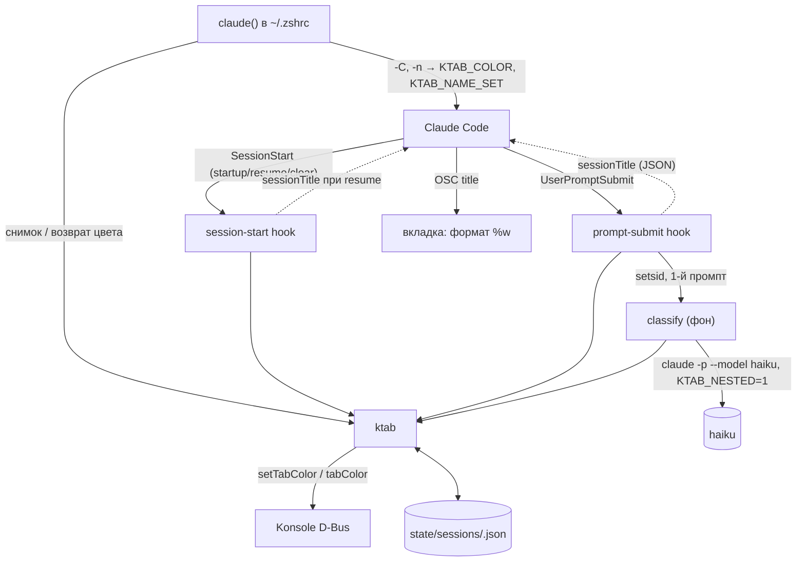
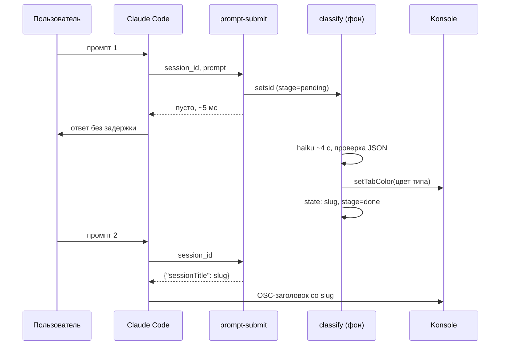
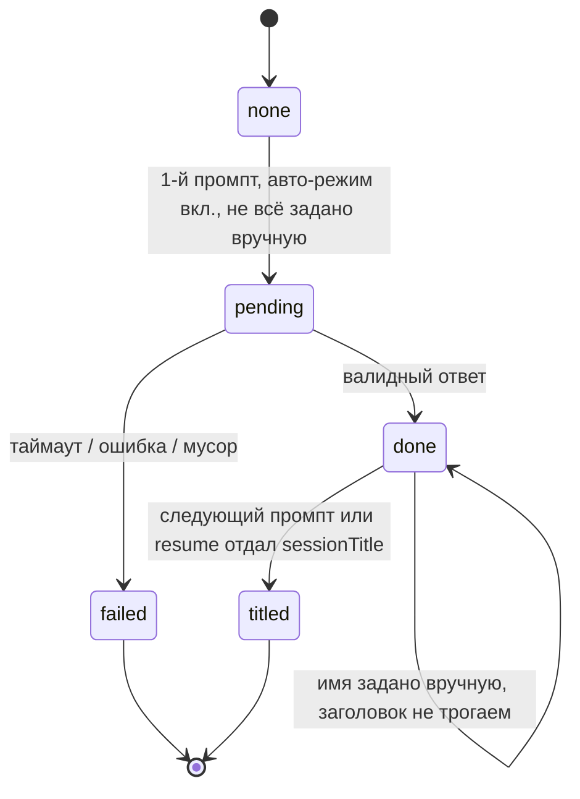

# Konsole Tabs for Claude Code - Plan

## Goal Capsule

- **Цель:** вкладка Konsole с сессией Claude Code получает имя и цвет: вручную флагами при запуске или автоматически по первому промпту. Цвет заливает вкладку целиком.
- **Приоритет источников:** при расхождении по поведению побеждает Product Contract (R-ID), по механизму реализации — Key Technical Decisions (KTD). Implementation Units не переопределяют ни то, ни другое.
- **Окружение:** машина автора: Arch-подобный дистрибутив, Konsole 26.08.2, Claude Code 2.1.310, zsh + oh-my-zsh, несколько аккаунтов Claude.
- **Профиль исполнения:** bash + jq для всего, что запускается на каждый промпт (KTD2). C++ только в патче Konsole (U6). Тесты — bash-харнесс с подставными `qdbus6` и `claude` (KTD9).
- **Стоп-условия:** остановиться и вынести вопрос пользователю, если (1) `sessionTitle` из хука не меняет имя сессии, (2) настройка плагина не доходит до хука как `CLAUDE_PLUGIN_OPTION_*`, (3) у вложенного `claude -p` срабатывают наши хуки, несмотря на KTD6. Это три непроверенных на практике допущения, на которых держится авто-режим.
- **Действия с sudo делает пользователь, не исполнитель:** установка недостающих зависимостей для сборки Konsole, правка `/etc/pacman.conf` (`IgnorePkg`) и установка собранного пакета. Исполнитель готовит и проверяет всё, что к ним ведёт, и передаёт готовые команды.
- **Завершение:** локальный git-репозиторий без remote, PR не открывается. Работа идёт на ветке и вливается в `master` по решению пользователя.
- **Открытые блокеры:** нет.

---

## Product Contract

**Product Contract preservation:** changed: R10 — имя появляется со второго промпта, цвет через ~4 с после первого (решение об авто-режиме в фоне, подтверждено пользователем). Добавлены R15 (ноль влияния на контекст и время основного чата) и R16 (поведение после `/clear`). Outstanding Questions решены и перенесены в KTD.

### Summary

Функция `claude` в `~/.zshrc` получает флаг `-C/--color` и вызывает общий скрипт `ktab`. Он красит вкладку через D-Bus Konsole и при выходе возвращает прежний цвет. Плагин Claude Code с двумя хуками восстанавливает цвет при resume, а в авто-режиме выбирает slug и цвет в фоновом процессе: цвет появляется через ~4 с, имя со второго промпта. Профиль Konsole переключается на формат заголовка `%w`. Пропатченная сборка Konsole, закреплённая через `IgnorePkg`, заливает вкладку цветом целиком.

### Problem Frame

Когда открыто несколько вкладок с Claude, они неразличимы: Konsole везде показывает `~ : claude`. Флаг `-n` у Claude Code есть, но имя до вкладки не доходит: профиль Konsole использует формат `%d : %n` и игнорирует заголовок, который выставляет программа. Цвет вкладки Konsole умеет задавать через D-Bus, но рисует его полоской в 4px под названием, на тёмной теме она почти незаметна. Сам Claude Code цвет вкладки не задаёт: `/color` красит только полосу ввода внутри Claude.

### Key Decisions

- **Только Konsole.** Другие терминалы требуют отдельных адаптеров, а часть (Ghostty, GNOME Terminal) цвет вкладки снаружи не принимает. (session-settled: user-directed — chosen over Konsole + другие Linux-терминалы: пользователь сузил объём до одного терминала, но довести его до конца)
- **Цвет на всю вкладку через патч Konsole.** Настройки Konsole и пользовательский CSS панели вкладок не дают разного цвета на каждую вкладку, другого пути к заливке нет. Цена — пересборка после обновлений Konsole. Governs R6, R7. (session-settled: user-approved — chosen over эмодзи-кружок в имени: нужна заливка вкладки целиком)
- **Флаг `-C/--color`, а не `-c`.** `-c` занят `--continue`. Governs R2. (session-settled: user-approved — chosen over `--tab-color` и отдельную команду `cc`: короче, а пересечение с будущими флагами Claude сейчас маловероятно)
- **В названии вкладки — заголовок, который выставляет Claude (имя + значок статуса).** По значку видно, какая вкладка работает. Это меняет формат заголовка у всех вкладок Konsole. Governs R8. (session-settled: user-approved — chosen over «только имя через D-Bus в вкладках с Claude»: значок статуса полезнее чистого имени)
- **Авто-цвет по типу задачи.** Цвет что-то сообщает с первого взгляда, а не просто различает вкладки. Governs R10, R12. (session-settled: user-approved — chosen over хеш от имени, цвет по проекту и свободный выбор модели)
- **Авто-имя — короткий slug.** Пример: `extension-fix`. Governs R10. (session-settled: user-approved — chosen over встроенный AI-заголовок Claude и slug с префиксом проекта)
- **Авто-режим работает в фоне.** Первый промпт идёт без задержки, цвет появляется через ~4 с, имя со второго промпта. Governs R10, R15. (session-settled: user-approved — chosen over синхронный вызов с паузой ~4 с и вариант «имя только во вкладке»: задержка первого ответа хуже, чем имя на один промпт позже)
- **При resume возвращаются сохранённые имя и цвет.** Привычная вкладка не меняется от возобновления сессии. Governs R14. (session-settled: user-approved — chosen over «ничего не делать» и «перевыбрать по следующему промпту»)
- **Ручные флаги главнее авто-режима, по каждому полю отдельно.** Явное указание пользователя не перезаписывается. Governs R11.
- **Сбой в любом месте не мешает Claude запуститься и работать.** Инструмент косметический и не должен блокировать основной. Governs R4, R13.

### Requirements

**Ручной запуск**

- R1. `claude -n <имя>` показывает имя в названии вкладки Konsole.
- R2. `claude -C <цвет>` / `--color <цвет>` красит вкладку. Принимаются именованные цвета (как минимум red, green, blue, purple, orange, yellow, pink, cyan, gray) и hex `#rrggbb`.
- R3. Флаги работают через существующую функцию `claude` в `~/.zshrc`. Выбор аккаунта по папке и `--allow-dangerously-skip-permissions` сохраняются, остальные аргументы передаются Claude без изменений.
- R4. Вне Konsole или при неизвестном цвете `-C` не применяется: выводится короткое предупреждение, Claude запускается как обычно.
- R5. После выхода из Claude вкладке возвращается цвет, который был до запуска.

**Вид вкладки**

- R6. Цвет заливает вкладку целиком, а не рисуется полоской. Текст названия остаётся читаемым на любом цвете из R2.
- R7. Обновление Konsole через pacman не должно молча снимать патч: пользователь узнаёт, что патч слетел, и восстанавливает его одной командой.
- R8. Профиль Konsole показывает в названии вкладки заголовок, который выставляет программа: у Claude это имя и значок статуса, в обычной вкладке zsh — его собственный заголовок.

**Авто-режим**

- R9. Авто-режим включается и выключается в настройках плагина Claude Code. По умолчанию выключен.
- R10. Если авто-режим включён, по первому промпту выбираются slug-имя из 2–3 слов (kebab-case) и цвет по типу задачи. Первый промпт не задерживается. Цвет появляется примерно через 4 с, имя — со второго промпта во вкладке и внутри Claude (поле ввода, `/resume`).
- R11. Если `-n` или `-C` заданы при запуске, авто-режим не трогает это поле и выбирает только второе.
- R12. Тип задачи определяется из фиксированного набора, у каждого типа свой цвет: баг — красный, фича — зелёный, рефакторинг — синий, исследование — фиолетовый, остальное — серый.
- R13. Если выбрать имя и цвет автоматически не удалось (модель недоступна, долго отвечает, ответ непонятен), промпт обрабатывается как обычно, а вкладка остаётся как была.

**Возобновление и сброс**

- R14. Имя и цвет сохраняются для каждой сессии. При `--resume` и `--continue` они восстанавливаются сразу при запуске, и авто-режим их не перевыбирает.
- R16. После `/clear` (Claude начинает новую сессию) вкладка сохраняет текущий цвет. Если включён авто-режим, имя и цвет выбираются заново по следующему промпту. Цвет из `-C` остаётся в силе.

**Влияние на основной чат**

- R15. Инструмент ничего не добавляет в контекст модели основного чата. Хуки работают за десятки миллисекунд и не ждут фонового выбора имени и цвета.

### Acceptance Examples

- AE1. **Covers R1, R2, R5, R8.** **Given** Konsole с пропатченной сборкой. **When** `claude -n extension-fix -C purple`. **Then** вкладка целиком фиолетовая, в названии `extension-fix` со значком статуса Claude. После выхода из Claude цвет вкладки возвращается к прежнему.
- AE2. **Covers R11.** **Given** авто-режим включён. **When** `claude -n extension-fix` и первый промпт «почини падение при открытии вкладки». **Then** имя остаётся `extension-fix`, через несколько секунд вкладка становится красной (баг).
- AE3. **Covers R10, R12, R15.** **Given** авто-режим включён, флагов нет. **When** первый промпт «добавь экспорт отчёта в CSV». **Then** Claude отвечает без задержки, через ~4 с вкладка становится зелёной (фича), а после второго промпта получает имя вроде `csv-report-export`.
- AE4. **Covers R14.** **Given** сессия ранее называлась `extension-fix` и была красной. **When** `claude --resume` с выбором этой сессии. **Then** вкладка сразу красная и называется `extension-fix` ещё до первого нового промпта.
- AE5. **Covers R4.** **Given** запуск в терминале не Konsole. **When** `claude -C purple` (или в Konsole `claude -C notacolor`). **Then** одна строка предупреждения, Claude стартует как обычно.
- AE6. **Covers R7.** **Given** в репозиториях вышла новая версия Konsole. **When** пользователь запускает обновление системы. **Then** pacman сообщает, что пропускает обновление konsole, и пользователь пересобирает патч одной командой.
- AE7. **Covers R13.** **Given** авто-режим включён, сеть недоступна. **When** первый промпт. **Then** Claude работает как обычно, вкладка остаётся без изменений, сообщений об ошибке в чате нет.
- AE8. **Covers R16.** **Given** вкладка зелёная после авто-выбора, авто-режим включён. **When** `/clear` и новый промпт «разберись, почему тормозит сборка». **Then** вкладка остаётся зелёной до выбора, затем становится фиолетовой (исследование) и получает новое имя со следующего промпта.

### Scope Boundaries

- Терминалы кроме Konsole (Kitty, WezTerm, Ghostty и др.), VS Code и десктопное приложение Claude.
- Смена имени или цвета посреди сессии отдельной командой. Имя уже меняет встроенный `/rename`, цвет — только при следующем запуске.
- Своя таблица «тип задачи → цвет» в v1 не настраивается, таблица фиксирована (R12).

#### Deferred to Follow-Up Work

- Отправить патч заливки вкладки в апстрим KDE как опцию профиля. Тогда пропадёт необходимость пересборки (R7).

### Dependencies / Assumptions

- Проверено на машине: Konsole 26.08.2 принимает по D-Bus `setTabColor`, `tabColor`, `setTabTitleFormat` для текущей сессии (`KONSOLE_DBUS_SERVICE`, `KONSOLE_DBUS_SESSION` есть в окружении). Вызов занимает ~12 мс.
- Проверено: с форматом `%w` вкладка показывает заголовок, который выставляет Claude (`◑ Claude Code` без `-n`). Если `%w` пуст, Konsole показывает имя профиля (`src/session/SessionController.cpp` в исходниках Konsole, `sessionAttributeChanged`). oh-my-zsh (`termsupport.zsh`) выставляет заголовок для обычных вкладок.
- Проверено в бинарнике Claude Code 2.1.310: `hookSpecificOutput.sessionTitle` принимают хуки `UserPromptSubmit` и `SessionStart`. `userConfig` плагина имеет типы string/number/boolean/directory/file с `default`, значение приходит хуку как `$CLAUDE_PLUGIN_OPTION_<KEY>`. Есть асинхронные хуки (`async: true`). На практике не проверялось (стоп-условия Goal Capsule).
- Проверено: `claude -p --model haiku --no-session-persistence --setting-sources "" --tools "" --disable-slash-commands --strict-mcp-config` возвращает корректный JSON примерно за 4,0–4,4 с. `--bare` не подходит: требует `ANTHROPIC_API_KEY`, а вход через подписку.
- Konsole стоит из репозитория дистрибутива (26.08.2-1.1). Своя сборка из PKGBUILD Arch теряет оптимизации сборки дистрибутива.
- Два аккаунта Claude Code: функция `claude` в `~/.zshrc` выбирает `CLAUDE_CONFIG_DIR` по папке проекта. Плагин ставится в оба (U3).

---

## Planning Contract

### Key Technical Decisions

- KTD1. **Одна точка правды — скрипт `ktab` внутри плагина.** Таблица цветов, проверка цвета, вызовы D-Bus, определение Konsole и файл состояния живут в `plugin/bin/ktab`. Его вызывают и функция zsh (по пути в репозитории), и хуки (через `${CLAUDE_PLUGIN_ROOT}`). Скрипт лежит внутри плагина, потому что плагин при установке копируется в кэш Claude и не видит файлов вне своей папки.
- KTD2. **Хуки пишутся на bash + jq, без python.** Хук срабатывает на каждый промпт, а запуск bash + jq занимает ~5 мс против ~30–50 мс у python. Governs R15.
- KTD3. **Состояние сессий — JSON-файл на сессию в общем каталоге XDG.** Файл `${XDG_STATE_HOME:-~/.local/state}/claude-konsole-customize/sessions/<session_id>.json`, запись атомарная (временный файл + `mv`). Каталог общий для обоих аккаунтов: ID сессий уникальны, а у `CLAUDE_PLUGIN_DATA` своя копия на каждый аккаунт. Поля: цвет и его источник (manual/auto), источник имени (manual/auto/none), slug, тип, стадия выбора (pending/done/failed), применён ли заголовок.
- KTD4. **Функция zsh передаёт ручные флаги хукам через окружение.** Цвет уходит как проверенный hex в `KTAB_COLOR`, факт `-n`/`--name` — как `KTAB_NAME_SET=1`. Хуки наследуют окружение процесса Claude, поэтому `SessionStart` сохраняет ручной выбор под `session_id`. Функция при старте не знает ID сессии, а хук знает. Governs R11, R14.
- KTD5. **Авто-режим в два шага по разным промптам.** Первый `UserPromptSubmit` отмечает выбор как начатый, запоминает PID процесса Claude и запускает классификатор отсоединённым процессом. Это `setsid`, где stdin и stdout идут в `/dev/null`, stderr в лог, а текст промпта лежит во временном файле. Хук выходит без вывода. Открытый stderr держал бы хук до конца классификации. Классификатор красит вкладку сам, но только если процесс Claude ещё жив. Иначе обёртка уже вернула цвет, а перекраска после этого нарушила бы R5. Следующий `UserPromptSubmit` (или `SessionStart` при resume) находит slug и возвращает его как `sessionTitle`. Это происходит, только если у сессии нет другого имени: хук сравнивает `session_title` из входного JSON со slug. Непустое и отличное от slug имя (`-n`, `/rename`, старая сессия) считается ручным. Governs R10, R15. (session-settled: user-approved — chosen over синхронный хук: см. Key Decision «Авто-режим работает в фоне», Governs R10, R15)
- KTD6. **Защита от рекурсии у вложенного `claude -p`.** Вложенный вызов запускается с `--setting-sources ""`, чтобы не грузить плагины, и с `KTAB_NESTED=1`. Каждый хук первым делом выходит, если эта переменная задана. Без защиты вложенная сессия сама запустила бы классификатор.
- KTD7. **Классификатор доверяет ответу модели только после проверки.** Из ответа берётся первый JSON-объект. Тип должен быть одним из машинных имён R12: `bug` (red), `feature` (green), `refactor` (blue), `research` (purple), `other` (gray). Эти же имена используются в промпте классификатора, в таблице `ktab` и в тестах. Затем проверяется slug: он должен соответствовать `^[a-z0-9]+(-[a-z0-9]+){1,2}$` длиной до 32 символов. Иначе стадия становится failed и вкладка не меняется. Промпт обрезается до 2000 символов, вызов ограничен `timeout 20s`. Governs R13.
- KTD8. **Хуки ничего не пишут в stdout, кроме JSON с `sessionTitle`.** Обычный текст из stdout хуков `UserPromptSubmit` и `SessionStart` Claude добавляет в контекст модели. Поэтому вывод либо пуст, либо это JSON только с `hookSpecificOutput.sessionTitle`. Без `additionalContext` и `systemMessage`. Диагностика пишется в лог в каталоге состояния, в stderr ничего не уходит. Код выхода всегда 0. Governs R13, R15.
- KTD9. **Тесты — свой bash-харнесс с подставными командами.** `bats` и `shellcheck` не установлены, ставить зависимости ради нескольких скриптов не стоит. Подставные `qdbus6` и `claude` в `tests/shims/` пишут вызовы в лог и отдают заданные ответы. Тесты подменяют `PATH`, `XDG_STATE_HOME` и переменные Konsole. Если `shellcheck` есть, проверка гоняет и его.
- KTD10. **Плагин ставится из локального marketplace в репозитории во все аккаунты.** Корень репо содержит `.claude-plugin/marketplace.json` с источником `./plugin`. `install.sh` выполняет `claude plugin marketplace add` и `install` для `~/.claude` (или списка из `KTAB_CONFIG_DIRS`), а при повторном запуске обновляет. `--plugin-dir` в обёртке не используется: не гарантировано, что такой плагин получит настройки `userConfig` в `/plugin` (R9).
- KTD11. **Формат заголовка задаёт свой профиль Konsole, а не D-Bus из обёртки.** Скрипт создаёт профиль на основе текущего встроенного с `LocalTabTitleFormat=%w` и `RemoteTabTitleFormat=%w` и делает его профилем по умолчанию в `konsolerc` с резервной копией. Новые вкладки сразу получают `%w`, обёртке ничего не нужно восстанавливать. Уже открытые вкладки подхватят формат после переоткрытия. Governs R8.
- KTD12. **Патч рисует заливку поверх стандартной отрисовки и заново выводит подпись.** Правка затрагивает только `DetachableTabBar::paintEvent` в `src/widgets/DetachableTabBar.cpp` Konsole. Для вкладки с цветом:
  1. залить прямоугольник вкладки со скруглением; у активной вкладки — полный цвет, у неактивных — приглушённый, чтобы активная оставалась заметной;
  2. заново нарисовать подпись средствами стиля (`CE_TabBarTabLabel`) цветом текста, выбранным по яркости заливки (чёрный или белый);
  3. сохранить полоску прогресса.

  Кнопки закрытия — отдельные виджеты и остаются сверху. Порядок «заливка до стандартной отрисовки» не подходит: Breeze закрашивает фон активной вкладки своим цветом. Governs R6.
- KTD13. **Своя сборка Konsole из PKGBUILD Arch с закреплением через `IgnorePkg`.** `konsole/rebuild.sh`:
  1. берёт PKGBUILD из `gitlab.archlinux.org/archlinux/packaging/packages/konsole` по тегу версии из `pacman -Si extra/konsole`. Тега `26.08.2-1.1` (версия дистрибутива) у Arch нет;
  2. добавляет патч в `source` и `prepare()`, пересчитывает суммы через `updpkgsums`;
  3. ставит `pkgrel` выше репозиторного (`<orig>.90`);
  4. импортирует ключи из `validpgpkeys` PKGBUILD (`gpg --recv-keys`). Если не вышло, останавливается с понятным сообщением;
  5. проверяет `depends`/`makedepends` через `pacman -T`. Если чего-то нет, печатает одну готовую команду `sudo pacman -S --needed --asdeps …` для пользователя и останавливается;
  6. собирает через `makepkg` без `-s` и печатает команду установки.

  Режим `--check` сравнивает установленную пропатченную версию с той, которую поставил бы pacman: это первая запись `pacman -Si konsole`, сейчас репозиторий дистрибутива. Строка `IgnorePkg = konsole` в `/etc/pacman.conf` заставляет pacman предупреждать «ignoring package upgrade», а не молча ставить непропатченную версию. Governs R7.
- KTD14. **Функция zsh всегда запоминает и возвращает цвет вкладки, даже без `-C`.** Цвет могут поменять и авто-режим, и восстановление при resume. Возврат делается через `always`-блок zsh, поэтому срабатывает и при Ctrl+C. Отсутствие цвета Konsole отдаёт как `#000000`, а `setTabColor("#000000")` красит вкладку настоящим чёрным (`Session::tabColor()` в исходниках Konsole). Поэтому `ktab` читает `#000000` как «нет цвета» и сбрасывает цвет пустой строкой. Чёрного нет и в палитре R2. Governs R5.

### High-Level Technical Design

Компоненты и потоки данных:



Авто-режим во времени, без флагов (KTD5):



Стадии авто-выбора в файле состояния (KTD3):



### Assumptions

- Claude сохраняет имя, заданное через `sessionTitle`, в данных сессии и возвращает его при resume, как делает с `/rename`. Если нет, `SessionStart` при resume отдаёт сохранённый slug (это проверяется в U4).
- Переменные `KONSOLE_DBUS_*` доходят до процессов хуков и до отсоединённого классификатора: хуки запускаются дочерними процессами Claude и наследуют его окружение.

### Risks

| Риск | Что делаем |
|---|---|
| Обновление Qt/KF6 ломает удерживаемый через `IgnorePkg` Konsole | `rebuild.sh` пересобирает ту же версию против новых библиотек. README описывает этот случай. |
| Перерисовка подписи расходится с Breeze (сдвиг, иконка, обрезка) | Подпись рисуется через стиль с его же `QStyleOptionTab`. Проверка — скриншот (U6). |
| На цветных вкладках пропадает подсветка активности (Konsole меняет цвет текста вкладки при выводе в фоне) | Принято: подпись берёт цвет по контрасту. Записано в README. |
| Новая версия Claude Code меняет схему хуков или `userConfig` | Стоп-условия Goal Capsule, тесты хуков на формат вывода, сбои молчаливые (KTD8). |
| `-C`/`--color` займёт сам Claude Code | Функция zsh разбирает аргументы только до `--`. Заметно сразу, переименование флага — одна правка. |

---

## Output Structure

```text
claude-konsole-customize/
  README.md
  install.sh
  .claude-plugin/marketplace.json
  plugin/
    .claude-plugin/plugin.json
    hooks/hooks.json
    bin/ktab
    scripts/session-start.sh
    scripts/prompt-submit.sh
    scripts/classify.sh
  shell/claude-konsole.zsh
  konsole/
    patches/0001-full-tab-color.patch
    rebuild.sh
    setup-profile.sh
  tests/
    run.sh
    lib.sh
    shims/qdbus6
    shims/claude
    *.test.sh
  docs/plans/
```

---

## Implementation Units

### U1. Ядро `ktab`: цвета, D-Bus, состояние

**Goal:** один скрипт, через который остальные части красят вкладку, читают её цвет и работают с состоянием сессий.

**Requirements:** R2, R4, R12, R14; KTD1, KTD3.

**Dependencies:** нет.

**Files:**
- `plugin/bin/ktab`
- `tests/lib.sh`, `tests/run.sh`, `tests/shims/qdbus6`
- `tests/ktab.test.sh`

**Approach:**
1. Подкоманды: разрешить цвет (имя или hex → hex, иначе ошибка), покрасить вкладку, прочитать текущий цвет, сбросить цвет, проверить, что мы в Konsole, прочитать и записать состояние сессии (слиянием полей), выдать цвет по типу задачи (машинные имена из KTD7). Чтение цвета возвращает `#000000` как пустое значение, а сброс вызывает `setTabColor ""` (KTD14).
2. Konsole определяется по `KONSOLE_DBUS_SERVICE` + `KONSOLE_DBUS_SESSION` и наличию `qdbus6`. Сбой D-Bus — ненулевой код без вывода в stdout.
3. Палитра: насыщенные цвета, на которых выбор чёрного или белого текста по яркости остаётся читаемым (R6).

**Patterns to follow:** вызов D-Bus через массив аргументов (`S=(qdbus6 $SERVICE $SESSION)`). В zsh строка с пробелами не разбивается на слова, это уже ломалось при исследовании.

**Test scenarios:**
- `purple`, `Purple` и `#8e44ad` разрешаются в один и тот же hex. `#8E44AD` нормализуется в нижний регистр.
- `notacolor`, `#12345` и пустая строка дают ошибку с ненулевым кодом.
- В Konsole покраска вызывает `setTabColor` с правильными service/session и hex (проверка по логу подставного `qdbus6`).
- Без `KONSOLE_DBUS_SESSION` покраска возвращает «не Konsole», `qdbus6` не вызывается.
- Подставной `qdbus6` падает — `ktab` возвращает ошибку, stdout пуст.
- Запись состояния для новой сессии создаёт файл. Повторная запись другого поля сохраняет первое. После записи во временном каталоге не остаётся лишних файлов.
- Тип `bug` даёт красный, `feature` зелёный, `refactor` синий, `research` фиолетовый, `other` и неизвестный тип серый.
- Konsole отдаёт `#000000`: чтение возвращает пустое значение. Сброс вызывает `setTabColor` с пустой строкой, а не с `#000000`.
- `black` и `#000000` в `-C` отклоняются как неизвестный цвет.

**Verification:** `bash tests/run.sh` проходит для `ktab.test.sh`. Ручной вызов покраски в живом Konsole меняет вкладку.

### U2. Флаги `-C/--color` в функции `claude`

**Goal:** `claude -n x -C purple` красит вкладку, передаёт ручной выбор хукам и возвращает цвет после выхода, сохраняя выбор аккаунта.

**Requirements:** R1, R2, R3, R4, R5, R11; KTD4, KTD14.

**Dependencies:** U1.

**Files:**
- `shell/claude-konsole.zsh` (функция-запускатор, которую вызывает `claude()`)
- `~/.zshrc` (вне репо: в обеих ветках `command claude` заменяется вызовом запускатора, добавляется `source`. Перед правкой делается резервная копия)
- `tests/shims/claude`, `tests/zsh-wrapper.test.sh`

**Approach:**
1. Запускатор принимает аргументы и окружение, которые формирует существующая `claude()`. Логика выбора аккаунта остаётся в `~/.zshrc`, меняется только последний вызов.
2. Аргументы разбираются до `--`: `-C X`, `-C=X`, `--color X`, `--color=X` изымаются. Наличие `-n`/`--name` (в любой форме) выставляет `KTAB_NAME_SET=1`, сами флаги остаются.
3. Цвет проверяется через `ktab`. Неизвестный цвет или запуск не в Konsole — одна строка предупреждения в stderr, запуск продолжается (R4).
4. Снимок цвета вкладки, покраска, затем `command claude` с `KTAB_COLOR`/`KTAB_NAME_SET`. В `always`-блоке цвет возвращается (KTD14), код выхода Claude сохраняется.

**Test scenarios:**
- Covers AE1. `claude -n extension-fix -C purple`: подставной `claude` получает `-n extension-fix` без `-C purple`, видит `KTAB_COLOR=#…` и `KTAB_NAME_SET=1`. `setTabColor` сначала с фиолетовым, после выхода с исходным цветом.
- `--color=red` и `-C red` дают одинаковый результат.
- Covers AE5. `-C notacolor` в Konsole: одна строка предупреждения, `claude` запущен, `KTAB_COLOR` не задан.
- Covers AE5. Вне Konsole `-C purple`: предупреждение, `qdbus6` не вызывается, `claude` запущен.
- `claude -p "-C purple"` и `claude -- -C purple`: аргументы после `--` и значения других флагов не трогаются.
- Без `-C`: вкладка не красится, но цвет снимается и возвращается после выхода (KTD14).
- Вкладка была без цвета (подставной `qdbus6` отдаёт `#000000`): после выхода `setTabColor` вызывается с пустой строкой.
- Подставной `claude` выходит с кодом 3: функция возвращает 3, цвет восстановлен.
- В папке второго аккаунта по-прежнему выставляется его `CLAUDE_CONFIG_DIR` и передаётся `--allow-dangerously-skip-permissions` (R3).

**Verification:** тесты проходят. Ручной запуск `claude -n test -C purple` в живом Konsole красит вкладку, после `/exit` цвет возвращается.

### U3. Плагин: каркас, хук `SessionStart`, установка в оба аккаунта

**Goal:** плагин ставится в оба аккаунта, сохраняет ручной выбор под ID сессии и восстанавливает цвет и имя при resume.

**Requirements:** R9 (каркас настройки), R14, R15, R16; KTD3, KTD4, KTD8, KTD10.

**Dependencies:** U1.

**Files:**
- `plugin/.claude-plugin/plugin.json` (с `userConfig.auto_mode`: boolean, `default: false`)
- `plugin/hooks/hooks.json`
- `plugin/scripts/session-start.sh`
- `.claude-plugin/marketplace.json`, `install.sh`
- `tests/session-start.test.sh`

**Approach:**
1. Хук читает JSON со stdin (`session_id`, `source`, `session_title`). Сначала проверка `KTAB_NESTED` (KTD6). Непустой `session_title`, отличный от сохранённого slug, отмечает имя как ручное (KTD5).
2. `startup`/`clear`: если задан `KTAB_COLOR`, сохранить цвет как manual и покрасить. Если задан `KTAB_NAME_SET`, отметить имя как manual. Для `clear` без `KTAB_COLOR` ничего не делать: цвет вкладки остаётся (R16).
3. `resume`: если есть состояние и цвет не задан вручную при этом запуске, покрасить сохранённым. Если `KTAB_COLOR` задан, он важнее и перезаписывает сохранённый (R11). Если slug выбран, но ещё не применён, вывести `sessionTitle` и отметить применённым.
4. `install.sh` идемпотентен. Для каждого `CLAUDE_CONFIG_DIR` из списка он добавляет marketplace (или обновляет) и ставит или обновляет плагин.

**Test scenarios:**
- Covers AE1. `startup` с `KTAB_COLOR` и `KTAB_NAME_SET`: состояние содержит цвет и имя как manual, `setTabColor` вызван, stdout пуст.
- Covers AE4. `resume` для сессии с сохранённым красным цветом и без `KTAB_COLOR`: `setTabColor` с красным, stdout пуст (slug уже применён).
- `resume` для сессии со slug, ещё не применённым: stdout — валидный JSON ровно с `hookSpecificOutput.hookEventName` и `sessionTitle`, состояние отмечено.
- `resume` с `KTAB_COLOR=#…` при сохранённом другом цвете: красится ручным, состояние перезаписано.
- `resume` старой сессии с именем (`session_title` непустой) и без файла состояния: имя записано как ручное, `sessionTitle` не выводится.
- Covers AE8. `clear` без `KTAB_COLOR`: `qdbus6` не вызывается, stdout пуст.
- Неизвестная сессия при `resume`, битый JSON на входе, отсутствие Konsole: код 0, stdout пуст (KTD8).
- `KTAB_NESTED=1`: хук выходит сразу, никаких вызовов и записей.

**Verification:** тесты проходят. После `install.sh` плагин виден в `/plugin` обоих аккаунтов. В живом Konsole `claude -C red`, `/exit`, затем `claude --resume` дают красную вкладку до первого промпта.

### U4. Авто-режим: хук `UserPromptSubmit` и фоновый классификатор

**Goal:** при включённой настройке плагина первый промпт запускает фоновый выбор цвета и slug, а следующий промпт применяет имя.

**Requirements:** R9, R10, R11, R12, R13, R15, R16; KTD5, KTD6, KTD7, KTD8.

**Dependencies:** U3.

**Files:**
- `plugin/scripts/prompt-submit.sh`, `plugin/scripts/classify.sh`
- `plugin/hooks/hooks.json` (регистрация `UserPromptSubmit`)
- `tests/prompt-submit.test.sh`, `tests/classify.test.sh`

**Approach:**
1. `prompt-submit.sh`: защита `KTAB_NESTED`, затем чтение `session_id`, `prompt` и `session_title`. Непустой `session_title`, отличный от slug, отмечает имя как ручное (KTD5).
   - Есть slug, он не применён и имя не ручное: вывести `sessionTitle`, отметить.
   - Иначе, если включён авто-режим (`CLAUDE_PLUGIN_OPTION_AUTO_MODE` равно строке `true`), выбора ещё не было, а цвет или имя не заданы вручную: записать `pending` и PID процесса Claude (родителя хука), сохранить промпт во временный файл и запустить `classify.sh` через `setsid` со всеми тремя потоками перенаправленными (KTD5).
   - Выход 0 без вывода.
2. `classify.sh`: вызов haiku с флагами из KTD6 и `timeout 20s`, разбор и проверка по KTD7. Затем, если цвет не ручной и процесс Claude жив (`kill -0` по сохранённому PID), покраска цветом типа. После этого запись `done` со slug или `failed`. Временный файл с промптом удаляется в любом случае.
3. Точное имя переменной настройки (регистр ключа) проверить первым делом на живом Claude: это стоп-условие Goal Capsule.

**Execution note:** перед тестами вручную проверить три допущения из стоп-условий: что `sessionTitle` из `UserPromptSubmit` переименовывает сессию, что `CLAUDE_PLUGIN_OPTION_AUTO_MODE` доходит до хука, что `--setting-sources ""` не грузит плагин во вложенном вызове. Попутно проверить:
- сохранение имени при resume (Assumptions);
- спрашивает ли `claude plugin install` настройку интерактивно и задана ли переменная, пока настройку не трогали (если нет, авто-режим считается выключенным);
- не вызывается ли `SessionStart(startup)` до `resume` при выборе сессии в меню `--resume`.

**Test scenarios:**
- Covers AE3. Авто-режим включён, состояния нет: хук завершается быстрее 100 мс при подставном `claude`, который «думает» 2 с. stdout и stderr хука читаются через пайпы до EOF, и EOF приходит до окончания классификации. stdout пуст, состояние `pending` с PID, классификатор запущен (по логу подставного `claude`).
- Пользователь сделал `/rename` между первым и вторым промптом (`session_title` отличается от slug): `sessionTitle` не выводится, имя отмечено как ручное.
- Covers AE3. Второй промпт после `done` со slug `csv-report-export`: stdout — JSON с `sessionTitle: "csv-report-export"`, третий промпт — пусто.
- Covers AE2. `KTAB_NAME_SET` отмечен в состоянии: классификатор запускается, после `done` вкладка красится, но `sessionTitle` не выводится никогда.
- Цвет и имя заданы вручную: классификатор не запускается.
- Авто-режим выключен или переменная не задана: ничего не запускается, stdout пуст.
- Состояние `pending` или `failed`: повторного запуска нет.
- `KTAB_NESTED=1`: хук выходит сразу.
- Классификатор: ответ `{"type":"feature","slug":"csv-report-export"}`, обёрнутый в текст или markdown-блок, разбирается, вкладка красится зелёным, состояние `done`.
- Covers AE7. Классификатор: подставной `claude` падает, превышает таймаут или отвечает `{"type":"weird","slug":"Bad Slug!"}` — состояние `failed`, `qdbus6` не вызывается.
- Классификатор: промпт с кавычками, `$()`, переводами строк и длиной 10 000 символов доходит до `claude` как один аргумент, обрезанный до 2000 символов. Подстановок в оболочке нет.
- Классификатор: цвет задан вручную — `qdbus6` не вызывается, slug сохраняется.
- Классификатор: сохранённый PID процесса Claude уже мёртв — `qdbus6` не вызывается, slug и `done` сохраняются.
- Covers AE8. После `clear` новая сессия без состояния при включённом авто-режиме запускает классификатор заново.

**Verification:** тесты проходят. В живом Konsole с включённой настройкой первый промпт отвечает без паузы, вкладка перекрашивается за ~5 с, после второго промпта у вкладки и в `/resume` новое имя.

### U5. Профиль Konsole с форматом `%w`

**Goal:** новые вкладки Konsole показывают заголовок, который выставляет программа.

**Requirements:** R1, R8; KTD11.

**Dependencies:** нет.

**Files:**
- `konsole/setup-profile.sh`
- `tests/setup-profile.test.sh`

**Approach:**
1. Скрипт создаёт в `~/.local/share/konsole/` профиль с `Parent=FALLBACK/` и `[General] LocalTabTitleFormat=%w`, `RemoteTabTitleFormat=%w` и делает его профилем по умолчанию в `~/.config/konsolerc`. Перед правкой делает резервную копию с меткой времени.
2. Повторный запуск ничего не дублирует. Флаг `--revert` возвращает резервную копию `konsolerc`.
3. Пути к конфигам берутся из `XDG_CONFIG_HOME`/`XDG_DATA_HOME` с умолчаниями, чтобы тест работал во временном каталоге.

**Test scenarios:**
- Чистый каталог: создан профиль с нужными ключами, `konsolerc` указывает на него, есть резервная копия.
- Повторный запуск: файлы не меняются, вторая резервная копия не создаётся.
- `konsolerc` с другими секциями: они сохраняются нетронутыми.
- `--revert` возвращает исходный `konsolerc`.

**Verification:** после запуска новая вкладка с zsh показывает путь от oh-my-zsh. Вкладка с `claude -n test` показывает `test` со значком статуса.

### U6. Патч Konsole: заливка вкладки и пересборка

**Goal:** цветная вкладка залита целиком, подпись читаема, а обновление Konsole не снимает патч молча.

**Requirements:** R6, R7; KTD12, KTD13.

**Dependencies:** нет (проверка вместе с U1/U2 удобнее, но не обязательна).

**Files:**
- `konsole/patches/0001-full-tab-color.patch` (против тега `v26.08.2`, файл `src/widgets/DetachableTabBar.cpp`)
- `konsole/rebuild.sh`

**Approach:**
1. Патч меняет только тело цикла в `DetachableTabBar::paintEvent` по KTD12. Порог контраста — относительная яркость цвета. Приглушённость неактивных вкладок выбирается при проверке на скриншотах.
2. `rebuild.sh` проходит шаги KTD13 по порядку, сборка идёт во временном каталоге. Если на шаге с зависимостями чего-то не хватает, скрипт печатает команду для пользователя и выходит с ненулевым кодом. Повторный запуск после установки продолжает работу. В конце выводятся путь к пакету и команда `sudo pacman -U …`.
3. `rebuild.sh --check` печатает: «пропатчено, актуально», «доступна новая версия, пересоберите» или «стоит непропатченная версия». Пропатченный пакет определяется по суффиксу `pkgrel`.
4. Если патч не применяется к новой версии, скрипт останавливается с понятным сообщением и не собирает пакет.

**Execution note:** проверка дымовая: сборка проходит, пакет ставит пользователь, затем скриншот вкладок через `spectacle -a -b -n -o <файл>` и осмотр. Автотест отрисовки не пишем.

**Test scenarios:**
- Test expectation: модульных тестов нет — отрисовка Qt проверяется сборкой и скриншотом. Сценарии проверки на скриншоте:
  - Covers AE1. Активная фиолетовая вкладка залита целиком, текст белый и читаемый.
  - Неактивные цветные вкладки залиты приглушённо, активная заметно выделяется.
  - Жёлтая и светло-серая вкладки получают чёрный текст.
  - Вкладка без цвета выглядит как в стандартном Konsole.
  - Кнопка закрытия видна и работает на цветной вкладке.
  - Полоска прогресса (например, при `sleep`-цикле с OSC прогресса) рисуется поверх заливки.
- Covers AE6. `rebuild.sh --check` при подменённой репозиторной версии выше установленной выводит «доступна новая версия».

**Verification:** `rebuild.sh` собирает пакет. После установки пользователем скриншот совпадает с ожиданиями выше. `pacman -Syu` при `IgnorePkg` выдаёт предупреждение о пропуске konsole.

### U7. README и заметка для восстановления на другой машине

**Goal:** установку, ручные шаги с sudo и известные ограничения можно повторить по документации без этой переписки.

**Requirements:** R7 (команда пересборки задокументирована), R9 (где включается авто-режим).

**Dependencies:** U1–U6.

**Files:**
- `README.md`
- личная заметка автора о восстановлении (вне репо)

**Approach:** README — краткая инструкция по порядку:
1. `install.sh`;
2. правка `~/.zshrc`;
3. `setup-profile.sh`;
4. `rebuild.sh` и установка пакета;
5. строка `IgnorePkg`.

Затем использование флагов, где включается авто-режим, таблица «тип → цвет» и известные ограничения: подсветка активности, потеря оптимизаций дистрибутива, пересборка после обновлений Qt/KF6.

**Test scenarios:** Test expectation: none — документация.

**Verification:** каждый шаг README выполняется дословно на этой машине.

---

## Verification Contract

| Гейт | Команда / действие | Когда |
|---|---|---|
| Модульные тесты скриптов | `bash tests/run.sh` (печатает итог и выходит с ненулевым кодом при падении) | U1–U5, перед каждым коммитом |
| Статический анализ | `shellcheck plugin/bin/ktab plugin/scripts/*.sh konsole/*.sh install.sh`, только если `shellcheck` установлен | U1–U6 |
| Ноль контекста | тесты U3/U4: stdout хуков пуст или ровно один JSON с `sessionTitle` | U3, U4 |
| Допущения о Claude Code | ручная проверка из Execution note U4 | до тестов U4 |
| Сборка Konsole | `konsole/rebuild.sh` завершается собранным пакетом | U6 |
| Живой сквозной прогон | AE1–AE8 вручную в Konsole после установки всего | после U7 |

---

## Definition of Done

- Все R1–R16 выполняются, AE1–AE8 проходят при ручном прогоне в живом Konsole с пропатченной сборкой.
- `bash tests/run.sh` зелёный. `shellcheck` без ошибок, если установлен.
- Плагин установлен и включается в `/plugin` обоих аккаунтов.
- Пользователь получил готовые команды для шагов с sudo (зависимости сборки, установка пакета, `IgnorePkg`), выполнил их и подтвердил результат.
- README описывает установку и ограничения.
- В репозитории нет экспериментального и брошенного кода, временных файлов и отладочного вывода в хуках.
